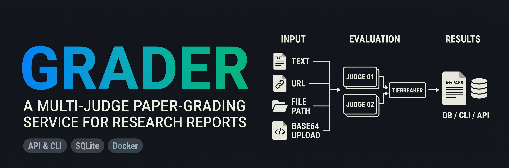

# Grader



A source-agnostic, multi-judge paper-grading service for research reports.

Grader accepts a report from text, a URL, an uploaded file, or an optional LDR
job; sends it through independent LLM judges; validates and combines their
scores; and stores every grade in SQLite. It exposes an HTTP API, a CLI, and an
optional Hermes plugin.

The core does **not** require LDR. LDR is one optional adapter; any pipeline can
submit a report directly.

## Features

- Source-agnostic ingestion: text, URL, file path, base64 upload, optional LDR.
- Two independent judges with a tiebreaker on disagreement or judge failure.
- Rubric-driven scoring with service-side weighted totals.
- Per-criterion scores, disagreement, confidence, fact errors, notes, cost,
  latency, and judge provenance.
- Persistent SQLite history with a canonical current grade per paper.
- Fast cache hits; force-regrade when a fresh judgment is needed.
- Batch API with CSV/JSON export and cost guardrails.
- Quality chart and JSON/CSV score history.
- Optional custom rubrics and query maps, mounted read-only.
- Docker-first deployment with a non-root, read-only container and health
  checks.
- No external notification dependency.

## Architecture

```text
text / URL / file / base64 upload / LDR job
                    │
              ingest adapter
                    │
             usability gate
                    │
        rubric resolution + prompt build
                    │
        ┌───────────┴───────────┐
   primary judge          secondary judge
        └───────────┬───────────┘
                    │
       validation + median per criterion
                    │
          disagreement detected?
             │              │
            no             yes
             │              │
             │        tiebreaker judge
             └──────┬───────┘
                    │
        weighted overall computed by service
                    │
       SQLite + judge runs + audit trail
                    │
       API / CLI / plugin / CSV / chart
```

The service calculates the weighted overall itself. Judge-provided totals are
never trusted.

## Scoring

| Criterion | Weight |
|---|---:|
| Factual accuracy | 25% |
| Coverage | 20% |
| Critical analysis | 20% |
| Source quality and citations | 15% |
| Structure and readability | 10% |
| Actionable conclusion | 10% |

Each criterion is scored `0–10`. The default rubric is
`generic_research_v1`, a neutral research-report rubric. Use a custom rubric
and optional query map when you have a domain-specific checklist.

## Quick start — image-only

The release image is self-contained:

```bash
mkdir -p ~/grader && cd ~/grader
gunzip -c grader-0.2.13.tar.gz | docker load
cp .env.example .env

# Set these two required values:
#   OPENROUTER_API_KEY=...
#   GRADER_API_TOKEN=...       (openssl rand -hex 32)

mkdir -p state
docker compose -f docker-compose.release.yml up -d
curl -sS http://127.0.0.1:9131/health/ready
```

The image-only Compose file has no `build:` section. It needs no source tree,
`config.json`, LDR installation, or Hermes installation.

## Quick start — source build

```bash
cd grader
cp .env.example .env
# set the two required secrets
mkdir -p state
docker compose build
docker compose up -d
curl -sS http://127.0.0.1:9131/health/ready
```

## Minimal docker-compose.yml

If you do not need the full release Compose file, this is enough:

```yaml
name: grader

services:
  grader:
    image: grader:0.2.13
    restart: unless-stopped
    user: "${GRADER_UID:-1000}:${GRADER_GID:-1000}"
    env_file: .env
    environment:
      GRADER_DATA_DIR: /data
      GRADER_LDR_ENABLED: "${GRADER_LDR_ENABLED:-false}"
    ports:
      - "9131:9131"
    volumes:
      - ./state:/data
    healthcheck:
      test:
        - CMD
        - python
        - -c
        - "import urllib.request; urllib.request.urlopen('http://127.0.0.1:9131/health/ready', timeout=3)"
      interval: 30s
      timeout: 5s
      retries: 3
```

Then:

```bash
mkdir -p state
docker load -i grader-0.2.13.tar.gz
docker compose up -d
curl -sS http://127.0.0.1:9131/health/ready
```

For a source build, replace `image: grader:0.2.13` with `build: .` and run
`docker compose up -d --build`.

The full [`docker-compose.release.yml`](docker-compose.release.yml) adds
read-only root, dropped capabilities, logging limits, and configurable bind
address/port/UID/GID. Use that for a production deployment.

## Configuration

Only two values are required:

| Variable | Purpose |
|---|---|
| `OPENROUTER_API_KEY` | One key for the judge models |
| `GRADER_API_TOKEN` | API token clients must present |

Common optional settings:

| Variable | Meaning | Default |
|---|---|---|
| `GRADER_BIND_IP` | Host interface to publish on | `0.0.0.0` |
| `GRADER_PUBLISH_PORT` | Host port | `9131` |
| `GRADER_STATE_DIR` | Host state directory | `./state` |
| `GRADER_WORKER_THREADS` | Grading workers | `2` |
| `GRADER_JUDGE_ATTEMPTS` | Retries per judge call | `4` |
| `GRADER_PRIMARY_MODEL` | Primary judge model | `deepseek/deepseek-v4-flash` |
| `GRADER_SECONDARY_MODEL` | Secondary judge model | `z-ai/glm-5.3-flash` |
| `GRADER_TIEBREAKER_MODEL` | Tiebreaker model | `deepseek/deepseek-v4-pro` |
| `GRADER_PRIMARY_PROVIDER_CHAIN` | Ordered primary provider chain | unset |
| `GRADER_SECONDARY_PROVIDER_CHAIN` | Ordered secondary provider chain | unset |
| `GRADER_TIEBREAKER_PROVIDER_CHAIN` | Ordered tiebreaker provider chain | unset |
| `GRADER_LDR_ENABLED` | Enable the optional LDR watcher | `false` |
| `GRADER_LDR_BASE` | LDR API base | `http://127.0.0.1:5000` |
| `GRADER_RUBRIC_OVERLAY` | Custom rubric directory | unset |
| `GRADER_QUERIES_FILE` | Optional custom query map | bundled map |

`config.json` is optional; `{}` is sufficient. All model roles use OpenRouter
by default and can be changed to another compatible gateway and model IDs.

Provider chains follow the same semantics as Curator: the first provider is
preferred, later entries are fallback tiers, and the chain is also the
whitelist. A chain only applies when the model's vendor prefix is present in
that role's chain; otherwise OpenRouter default routing is used. Leave a chain
unset for default routing. A one-entry chain means primary-only for that role.

## API

Authentication uses:

```http
X-API-Token: <token>
```

or:

```http
Authorization: Bearer <token>
```

| Method | Path | Purpose |
|---|---|---|
| `POST` | `/v1/papers` | Ingest text/file/URL/upload and optionally grade |
| `POST` | `/v1/papers/from-ldr/{job_id}` | Optional LDR ingestion |
| `POST` | `/v1/grades` | Grade or force-regrade a paper |
| `POST` | `/v1/batches` | Grade a batch of paper IDs |
| `GET` | `/v1/jobs/{job_id}` | Job status and result |
| `GET` | `/v1/jobs?status=failed` | List failures |
| `POST` | `/v1/jobs/{job_id}/retry` | Retry a failed job |
| `GET` | `/v1/papers/{paper_id}` | Paper metadata |
| `GET` | `/v1/papers/{paper_id}/current-grade` | Canonical current grade |
| `GET` | `/v1/grades/{grade_id}` | Grade plus judge runs |
| `GET` | `/v1/scores?format=json\|csv` | Score history |
| `GET` | `/v1/batches/{id}` | Batch status and cost |
| `GET` | `/v1/batches/{id}/export?format=csv` | Batch export |
| `GET` | `/v1/chart.png` | Quality chart |
| `GET` | `/health/live` | Liveness, no token |
| `GET` | `/health/ready` | DB/worker readiness, no token |
| `GET` | `/health` | Detailed diagnostics, token required |

Submit text:

```bash
curl -sS http://127.0.0.1:9131/v1/papers \
  -H "X-API-Token: $GRADER_API_TOKEN" \
  -H 'Content-Type: application/json' \
  -d '{
    "source_type": "text",
    "title": "My report",
    "content": "# Report\n...",
    "grade": true,
    "wait": true
  }'
```

Upload a file without a host mount:

```json
{
  "source_type": "file",
  "filename": "report.pdf",
  "content_base64": "...",
  "source_ref": "pipeline:report-42",
  "grade": true
}
```

Force a fresh judgment:

```json
{
  "paper_id": "...",
  "force": true,
  "wait": true
}
```

See [`INTEGRATION.md`](INTEGRATION.md) for the full contract.

## Optional LDR adapter

LDR is disabled by default. Enable it only when this deployment should poll an
LDR instance:

```dotenv
GRADER_LDR_ENABLED=true
GRADER_LDR_BASE=http://ldr-host:5000
LDR_USER=...
LDR_PASS=...
```

The watcher baselines existing history on first start, then grades new completed
jobs. Reports that are too short or empty are stored but not sent to judges.

## Custom rubrics

Mount a read-only directory and point the service at it:

```yaml
volumes:
  - "./state:/data"
  - "./custom-rubrics:/config/rubrics:ro"
```

```dotenv
GRADER_RUBRIC_OVERLAY=/config/rubrics
```

Add `custom-rubrics/<rubric_id>.md`, then submit with
`"rubric_id":"<rubric_id>"`. A custom `queries.json` can be mounted through
`GRADER_QUERIES_FILE`; unknown queries fall back to `generic_research_v1`.

## Reliability

- Each judge call retries up to 4 times with exponential backoff.
- Empty responses retry with a larger token budget and structured-output mode
  removed.
- Parse failures retry with a JSON-only correction prompt.
- A failed primary judge triggers the tiebreaker as a replacement.
- A disagreement above `1.0` overall or `2.0` on any criterion triggers
  adjudication.
- Three consecutive judge failures trigger a five-minute cooldown.
- Failed jobs retry up to 3 times, then remain visible with their error.
- Interrupted `running` jobs are requeued on startup.
- Daily SQLite backups are verified with `PRAGMA integrity_check` and retained
  for 30 snapshots.

## Development

```bash
python3 -m unittest discover -s tests -v
```

The suite is network-free. It covers validation, retries, fallback judging,
circuit breaking, rubric resolution, custom rubrics, ingestion, schema setup,
cache invalidation, forced regrades, and canonical current grades.

## Project layout

```text
grader/                 service package
  adapters/ldr.py       optional LDR adapter
  judges.py             judge calls, retries, validation
  pipeline.py           registration and grading pipeline
  server.py             HTTP API and worker queue
  db.py                 SQLite storage
  rubrics.py            rubric resolution
  charts.py             chart rendering
  cli.py                CLI client
tests/                  network-free tests
rubrics/                generic rubric
backup.py               verified SQLite backup
Dockerfile
docker-compose.yml      source build
docker-compose.release.yml image-only deployment
```

## Security and limitations

- Keep the API on a trusted LAN or put it behind TLS/reverse proxy if exposed.
- URL ingestion blocks obvious private/link-local targets, but does not pin DNS
  against rebinding.
- `generic_research_v1` is editorial scoring, not independent fact-checking.
- LLM judge scores are not a substitute for human calibration.
- LDR watcher only auto-grades jobs completed after its baseline.
- The image architecture is the build host architecture; use `docker buildx` for
  multi-arch releases.

## License

MIT. See [`LICENSE`](LICENSE).
